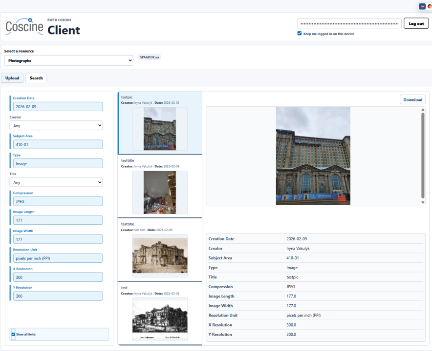

# Coscine Client

Coscine Client is a browser-based React application for working with RWTH Coscine resources. It helps users load Coscine projects, select resources, fill SHACL-based metadata forms, upload files with metadata, and inspect uploaded content.




## What It Does

- Connects to the production Coscine API through a local proxy.
- Loads projects, resources, files, and application profiles available to a Coscine API token.
- Renders SHACL metadata forms with `@ulb-darmstadt/shacl-form`.
- Serializes completed metadata as Turtle before upload.
- Uploads file content and metadata to a selected Coscine path.
- Provides a search and preview view for resource files.
- Supports English and German interface text.
- Can remember selected metadata field values in browser storage.

## Screens

### Production Resource View

The production workflow loads resources from Coscine, displays files in the selected resource, renders the resource metadata form, and previews downloadable files where possible.

## Requirements

- Node.js 20 or newer.
- npm.
- A Coscine API token.

## Installation

```bash
npm install
```

## Development

Start the Vite development server:

```bash
npm run dev
```

The application is served at:

```text
http://127.0.0.1:5173
```

During development, Vite proxies Coscine API requests through:

```text
/coscine-api
```

This keeps browser CORS handling out of the frontend code.

## Production Build

Build the static frontend:

```bash
npm run build
```

Serve the built app with the included Node.js server:

```bash
npm run serve
```

The server listens on:

```text
http://127.0.0.1:4173
```

Set `PORT` to use a different port:

```bash
PORT=8080 npm run serve
```

## Basic Workflow

1. Open Coscine Client in a browser.
2. Enter a Coscine API token and load resources.
3. Select a resource.
4. Load a local file and set the Coscine target path.
5. Fill the required metadata form.
6. Upload the file and serialized metadata.

API tokens are entered in the browser and sent as `Authorization` headers only to proxied Coscine API requests. Users can optionally keep a token in that browser's local storage to restore their login on later visits. Do not commit tokens or store them in source files.

## Scripts

- `npm run dev` starts the Vite development server.
- `npm run build` creates the production build in `dist/`.
- `npm run preview` previews the Vite build locally.
- `npm run serve` serves `dist/` with the included Node.js server and Coscine proxy.

## Project Structure

```text
.
├── index.html
├── Picture1.png
├── Picture2.png
├── server.js
├── src
│   ├── aimsApi.js
│   ├── assets
│   │   ├── aims_title_FHD_transparent_header.png
│   │   └── coscine_rgb.svg
│   ├── coscineApi.js
│   ├── main.jsx
│   └── styles.css
└── vite.config.js
```

## Technology

- React 19.
- Vite 6.
- N3 for Turtle parsing and serialization.
- `@ulb-darmstadt/shacl-form` for SHACL form rendering.
- A small Node.js server for serving production builds and proxying Coscine API requests.

## License

This project is licensed under the Apache License 2.0. See [LICENSE](LICENSE)
for the complete license terms.

## Citation

If you use Coscine Client in research or another published work, please cite
the software using the metadata in [CITATION.cff](CITATION.cff). Machine-readable
software metadata is also available in [codemeta.json](codemeta.json).
